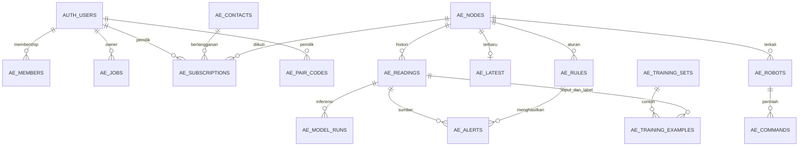

# Struktur Supabase AEROSENSE

Dokumen ini menjelaskan schema yang digunakan API dan workflow n8n, serta penambahan dari dokumen database pengguna. Schema dasar terdiri dari 15 tabel di `public`, satu view `ae_sensor_context`, dan satu bucket private `aerosense-audio`. Akun login disimpan pada `auth.users` yang dikelola Supabase.

Kolom pada bagian 1 sampai 15 mengikuti `001_aerosense.sql` dan `002_raw_model_history.sql`. Bagian pengembangan menjelaskan field tambahan yang belum dibuat oleh migrasi tersebut. Tabel lama tidak perlu diganti nama menjadi tabel dari dokumen usulan karena query n8n sudah memakai nama `ae_*`.

## Cara membaca tipe dan relasi

| Istilah | Arti |
| --- | --- |
| `uuid` | ID unik, biasanya dibuat dengan `gen_random_uuid()` |
| `text` | String, termasuk ID perangkat yang bisa dibaca manusia |
| `bigint` / `integer` | Bilangan bulat |
| `double precision` | Bilangan pecahan |
| `timestamptz` | Waktu dengan zona; API menggunakan format ISO 8601 |
| `jsonb` | Objek atau array JSON yang dapat diquery PostgreSQL |
| PK | Primary key, identitas unik baris |
| FK | Foreign key, referensi ke baris pada tabel lain |
| NN | NOT NULL, wajib mempunyai nilai |
| nullable | Boleh kosong atau NULL |

Nilai bawaan hanya mengisi kolom ketika nilainya tidak diberikan. `updated_at` pada schema saat ini diperbarui oleh query atau fungsi yang menulisnya; belum ada trigger umum untuk setiap UPDATE.

## Ringkasan tabel

| Kelompok | Tabel | Yang mengisi |
| --- | --- | --- |
| Master | `ae_nodes`, `ae_members`, `ae_robots` | Pengelola melalui SQL atau layanan pengelola |
| Sensor | `ae_readings`, `ae_latest`, `ae_model_runs` | API melalui `ae_ingest()` |
| Alert | `ae_rules`, `ae_alerts` | Pengelola dan `ae_evaluate()` |
| Pekerjaan | `ae_jobs` | API, fungsi database, dan worker n8n |
| WhatsApp | `ae_contacts`, `ae_subscriptions`, `ae_pair_codes` | Proses pesan, pairing, dan menu |
| Robot | `ae_commands` | API dan evaluasi alert |
| Training | `ae_training_sets`, `ae_training_examples` | `ae_training_snapshot()` |

## Relasi utama



Relasi diagram menunjukkan hubungan utama. Semua FK fisik dijelaskan pada tabel kolom. `location_id` pada node dan membership adalah hubungan logis melalui nilai teks yang sama; schema belum mempunyai tabel `ae_locations`.

## 1. `ae_nodes`

Identitas sensor dan lokasi yang dipakai peta, hak akses, dan robot.

| Kolom | Tipe | Aturan | Isi |
| --- | --- | --- | --- |
| `id` | text | PK | ID 1 sampai 40 karakter, huruf, angka, underscore, atau tanda hubung |
| `name` | text | NN | Nama titik pemantauan |
| `gateway_id` | text | NN | ID gateway yang berhak mengirim data node |
| `location_id` | text | NN | Kelompok lokasi untuk membership |
| `latitude` | double precision | NN, -90 sampai 90 | Latitude node |
| `longitude` | double precision | NN, -180 sampai 180 | Longitude node |
| `enabled` | boolean | NN, default true | Node diaktifkan untuk operasi |
| `pm25_validated` | boolean | NN, default false | Pengukuran PM2.5 telah tervalidasi |
| `calibration_version` | text | nullable | Versi kalibrasi yang benar-benar digunakan |
| `created_at` | timestamptz | NN, default now() | Waktu pendaftaran |

`gateway_id` dicocokkan dengan credential perangkat di API. Kolom ini belum FK ke tabel gateway. `enabled=false` berarti dinonaktifkan; status online/offline perlu dihitung dari waktu pembacaan, bukan dari kolom ini saja.

## 2. `ae_members`

Menentukan lokasi yang boleh dibaca seorang pengguna. Pengguna dapat mempunyai role berbeda pada lokasi berbeda.

| Kolom | Tipe | Aturan | Isi |
| --- | --- | --- | --- |
| `user_id` | uuid | Bagian PK, FK auth.users, ON DELETE CASCADE | Akun Supabase Auth |
| `location_id` | text | Bagian PK, NN | Lokasi yang diizinkan |
| `role` | text | NN | `viewer`, `operator`, `admin`, atau `auditor` |

PK gabungan: `(user_id, location_id)`. API memberi izin perubahan aturan, ACK alert, dan pengaturan robot kepada operator/admin. Viewer dan auditor membaca lokasi yang diberikan. Membership pada lokasi lain tidak otomatis memberi akses.

## 3. `ae_readings`

Log seluruh pembacaan yang diterima dan lolos validasi. Satu paket menghasilkan satu baris historis.

| Kolom | Tipe | Aturan | Isi |
| --- | --- | --- | --- |
| `id` | uuid | PK, default gen_random_uuid() | ID reading |
| `node_id` | text | NN, FK ae_nodes.id | Node sumber |
| `boot_id` | text | NN | Identitas sesi setelah perangkat boot |
| `sequence` | bigint | NN, minimal 0 | Nomor urut paket dalam sesi |
| `observed_at` | timestamptz | NN | Waktu pembacaan dilakukan |
| `received_at` | timestamptz | NN, default now() | Waktu diterima database |
| `metrics` | jsonb | NN | Nilai dalam unit fisik yang dipakai dashboard |
| `gru` | jsonb | nullable | Hasil dan metadata inferensi GRU |
| `quality` | jsonb | NN, default {} | Invalid flag, sumber waktu, versi kalibrasi |
| `raw_metrics` | jsonb | nullable, migrasi 002 | Nilai mentah sebelum konversi/preprocessing |
| `raw_payload` | jsonb | nullable, migrasi 002 | Paket asal tanpa secret perangkat |
| `raw_sha256` | text | nullable, migrasi 002 | Digest paket mentah |
| `processing` | jsonb | NN, default {}, migrasi 002 | Status dan informasi pemrosesan |

Unique `(node_id, boot_id, sequence)` mencegah paket ulang menambah histori. Index `(node_id, observed_at DESC)` membantu query histori. Paket terlambat yang lolos validasi tetap masuk histori; latest hanya berubah jika waktunya lebih baru. Validator API saat ini menolak observasi lebih dari 24 jam lalu atau lebih dari satu menit di masa depan, sehingga backlog harus mempunyai kebijakan untuk paket di luar rentang itu.

`metrics` menyimpan nilai fisik dan `gru` menyimpan estimasi model. Prediksi tidak boleh mengganti raw input atau diberi label sebagai pembacaan sensor aktual.

## 4. `ae_latest`

Satu baris per node untuk pembacaan terbaru. Jumlahnya tidak bertambah setiap lima menit.

| Kolom | Tipe | Aturan | Isi |
| --- | --- | --- | --- |
| `node_id` | text | PK, FK ae_nodes.id | Node |
| `reading_id` | uuid | nullable, FK ae_readings.id | Reading historis yang dirujuk |
| `observed_at` | timestamptz | NN | Waktu pengamatan terbaru |
| `received_at` | timestamptz | NN | Waktu penerimaan reading |
| `metrics` | jsonb | NN | Salinan nilai fisik |
| `gru` | jsonb | nullable | Salinan hasil GRU |
| `quality` | jsonb | NN | Salinan kualitas reading |

`ae_ingest()` melakukan upsert berdasarkan node. Data dengan `observed_at` sama atau lebih lama tidak mengganti baris yang sudah ada. Raw payload lengkap tetap berada di `ae_readings`.

## 5. `ae_model_runs`

Jejak input dan output model untuk mengkaji prediksi serta membandingkan versi.

| Kolom | Tipe | Aturan | Isi |
| --- | --- | --- | --- |
| `id` | uuid | PK, default gen_random_uuid() | ID inferensi |
| `reading_id` | uuid | NN, FK ae_readings.id | Reading yang terkait |
| `node_id` | text | NN, FK ae_nodes.id | Node |
| `model_name` | text | NN, default GRU | Jenis model |
| `model_version` | text | NN | Versi artifact model |
| `artifact_sha256` | text | nullable | Hash file model |
| `manifest_sha256` | text | nullable | Hash manifest fitur/scaler |
| `input_features` | jsonb | NN | Urutan nama fitur dan matriks input |
| `normalized_input` | jsonb | nullable | Matriks setelah scaler |
| `input_readings` | jsonb | NN, default [] | Identitas reading yang membentuk window |
| `output` | jsonb | NN | Output model dan metadata |
| `processed_at` | timestamptz | NN | Waktu inferensi |
| `predicted_for` | timestamptz | NN | Waktu yang diprediksi |

Unique `(reading_id, model_name, model_version)`. Index `(node_id, processed_at DESC)`. Ingest saat ini mencatat GRU bila sudah disertakan dalam payload gateway. API belum menyediakan endpoint khusus untuk melampirkan hasil model secara asinkron ke reading lama. Mode raw masuk lebih dahulu lalu model masuk belakangan membutuhkan endpoint atau transaksi tambahan dengan ID reading yang sama.

`input_readings` berupa JSON, sehingga tidak mempunyai FK per elemen. Identitas asal harus tetap valid dan lengkap. Schema dapat mencatat beberapa versi, tetapi alur ingest sekarang mengisi versi yang datang pada paket tersebut.

## 6. `ae_rules`

Aturan ambang operasional per node dan parameter.

| Kolom | Tipe | Aturan | Isi |
| --- | --- | --- | --- |
| `id` | uuid | PK, default gen_random_uuid() | ID aturan |
| `node_id` | text | NN, FK ae_nodes.id | Node |
| `metric` | text | NN, pilihan dibatasi | Nama parameter |
| `high` | double precision | NN | Ambang pemicu alert |
| `clear_below` | double precision | NN, lebih kecil dari high | Ambang melepas kondisi aktif |
| `enabled` | boolean | NN, default false | Aturan dipakai atau tidak |
| `unit` | text | NN | Unit angka |
| `cooldown_seconds` | integer | NN, default 1800, minimal 60 | Jeda alert ulang |
| `active` | boolean | NN, default false | Kondisi ambang masih aktif |
| `last_alert_at` | timestamptz | nullable | Alert terakhir |

Unique `(node_id, metric)`. Parameter yang tersedia: `dust_ug_m3`, `pm25_ug_m3`, `eco2_ppm`, `tvoc_ppb`, `temperature_c`, `humidity_pct`.

`high` dan `clear_below` membentuk hysteresis: alert muncul saat nilai >= high; kondisi aktif dilepas saat nilai <= clear_below. Keduanya bukan pasangan warning dan critical. Penambahan dua tingkat peringatan dari dokumen usulan memerlukan perubahan schema dan evaluator.

## 7. `ae_alerts`

Riwayat ambang terlampaui, terkait pembacaan dan aturan pemicunya.

| Kolom | Tipe | Aturan | Isi |
| --- | --- | --- | --- |
| `id` | uuid | PK, default gen_random_uuid() | ID alert |
| `node_id` | text | NN, FK ae_nodes.id | Node |
| `reading_id` | uuid | nullable, FK ae_readings.id | Reading pemicu |
| `rule_id` | uuid | nullable, FK ae_rules.id | Aturan pemicu |
| `metric` | text | NN | Parameter |
| `value` | double precision | nullable | Nilai saat alert |
| `threshold` | double precision | nullable | Ambang pada saat kejadian |
| `unit` | text | nullable | Unit |
| `created_at` | timestamptz | NN, default now() | Waktu pembuatan |
| `acknowledged_by` | uuid | nullable, FK auth.users.id | Pengguna yang meninjau |
| `acknowledged_at` | timestamptz | nullable | Waktu peninjauan |

Unique `(reading_id, rule_id)` mencegah alert ganda untuk reading dan aturan yang sama. ACK berarti telah ditinjau; schema belum menyimpan `resolved_at`, pesan khusus, atau severity. Kondisi kembali rendah mengubah `ae_rules.active`, tanpa otomatis menandai histori alert selesai ditangani.

Evaluator menggunakan `metrics` terukur. Data lebih lama dari 10 menit dan data dengan `quality.invalid=true` tidak memicu alert. Aturan PM2.5 hanya dipakai pada node tervalidasi. Dalam transaksi yang sama, alert membuat job kirim WhatsApp serta command robot prioritas 100.

## 8. `ae_jobs`

Penyimpanan pekerjaan yang sedang menunggu, diproses, atau selesai. Riwayat pertanyaan sementara juga berada di tabel ini.

| Kolom | Tipe | Aturan | Isi |
| --- | --- | --- | --- |
| `id` | uuid | PK, default gen_random_uuid() | Job ID yang dikirim pada event |
| `kind` | text | NN | Jenis layanan |
| `dedupe_key` | text | NN, unique | Identitas bisnis untuk mencegah duplikasi |
| `owner_id` | uuid | nullable, FK auth.users, ON DELETE CASCADE | Pemilik chat web atau request pengguna |
| `body` | jsonb | NN | Input pekerjaan |
| `result` | jsonb | nullable | Jawaban/status akhir |
| `stage` | jsonb | NN, default {} | Transkrip, konteks, atau hasil sementara |
| `status` | text | NN, default pending | pending/running/done/failed |
| `attempts` | integer | NN, default 0 | Jumlah klaim/pencobaan |
| `available_at` | timestamptz | NN, default now() | Waktu job boleh diambil |
| `lease_token` | uuid | nullable | Token kepemilikan sementara worker |
| `lease_until` | timestamptz | nullable | Batas waktu klaim |
| `last_error` | text | nullable | Error terakhir |
| `created_at` | timestamptz | NN, default now() | Waktu masuk |
| `updated_at` | timestamptz | NN, default now() | Waktu perubahan oleh proses |

Index `(kind, status, available_at)`. Kind adalah text tanpa CHECK enum pada schema dasar. Routing sekarang menerima enam jenis berikut; `operational` juga digunakan oleh maintenance sebagai log yang langsung selesai.

| Kind | Contoh body | Hasil |
| --- | --- | --- |
| `telemetry` | `reading_id` | Jumlah alert |
| `web_chat` | `text`, `node_ids` | Teks dan konteks pembacaan |
| `wa_inbox` | `phone`, objek `message` Meta | Pairing/menu/status pesan |
| `wa_chat` | `phone`, `text`, `node_ids` | Jawaban, dilanjutkan job kirim |
| `wa_send` | `phone`, `text`, interactive/template bila ada | Provider message ID atau alasan dilewati |
| `robot_chat` | `robot_id`, `node_ids`, text/audio | Jawaban dan command robot |

Claim memakai `FOR UPDATE SKIP LOCKED`, mengisi token, dan memberi lease lima menit. Satu worker tidak boleh menyelesaikan job memakai token worker lain. Lease mencegah klaim bersamaan; tidak menjamin provider eksternal selalu menerima pesan tepat sekali bila koneksi putus setelah pengiriman.

Retry maksimal lima attempt dengan backoff. Worker live juga membatasi usia job 24 jam. `ae_stage()` memperpanjang lease; `ae_finish()` menyimpan result, mengosongkan stage, dan menghapus `audio_base64` dari body. Teks dan hasil tetap tersedia sampai cleanup.

Histori ini belum otomatis menjadi memori percakapan Gemini. Pengiriman percakapan sebelumnya ke model perlu konfigurasi tambahan yang membatasi jumlah turn.

## 9. `ae_contacts`

| Kolom | Tipe | Aturan | Isi |
| --- | --- | --- | --- |
| `phone` | text | PK, 8 sampai 15 digit | Nomor format internasional tanpa + |
| `last_inbound_at` | timestamptz | NN | Pesan masuk terakhir |
| `last_provider_status` | jsonb | nullable | ID/status/timestamp provider |

Contoh format nomor Indonesia: `6281234567890`. Waktu masuk dipakai untuk pemeriksaan jendela layanan WhatsApp. Kontak tersimpan belum berarti menyetujui semua notifikasi.

## 10. `ae_subscriptions`

| Kolom | Tipe | Aturan | Isi |
| --- | --- | --- | --- |
| `phone` | text | Bagian PK, FK ae_contacts, ON DELETE CASCADE | Nomor pelanggan |
| `node_id` | text | Bagian PK, FK ae_nodes.id | Node yang diikuti |
| `user_id` | uuid | NN, FK auth.users, ON DELETE CASCADE | Akun pasangan |
| `opted_in_at` | timestamptz | NN, default now() | Waktu persetujuan |
| `active` | boolean | NN, default true | Langganan aktif |

PK `(phone, node_id)`. Pengguna harus tetap memiliki membership pada lokasi node. `BERHENTI` menonaktifkan langganan; menu juga dapat mengatur langganan node. Hak akses diperiksa kembali sebelum pengiriman alert.

## 11. `ae_pair_codes`

| Kolom | Tipe | Aturan | Isi |
| --- | --- | --- | --- |
| `code_hash` | text | PK | SHA256 kode, bukan kode asli |
| `user_id` | uuid | NN, FK auth.users, ON DELETE CASCADE | Pembuat kode |
| `node_id` | text | NN, FK ae_nodes.id | Node pasangan |
| `expires_at` | timestamptz | NN | Batas penggunaan |
| `used_at` | timestamptz | nullable | Waktu pertama dipakai |
| `used_by` | text | nullable | Nomor yang memakai |

API membuat kode 16 karakter hex dan memberi masa berlaku 10 menit. Pengguna mengirim `DAFTAR kode`. Kode yang dipakai nomor pertama tidak bisa diambil nomor lain; pengulangan oleh nomor yang sama bersifat idempoten selama masih berlaku.

## 12. `ae_robots`

| Kolom | Tipe | Aturan | Isi |
| --- | --- | --- | --- |
| `id` | text | PK | Robot ID |
| `node_id` | text | NN, FK ae_nodes.id | Node yang dibacakan robot |
| `enabled` | boolean | NN, default true | Robot diaktifkan |
| `quiet` | boolean | NN, default false | Mode tanpa keluaran suara |
| `presence_cooldown_seconds` | integer | NN, default 120, minimal 30 | Jeda sapaan infrared |
| `last_presence_at` | timestamptz | nullable | Presence terakhir yang diterima untuk sapaan |
| `last_seen_at` | timestamptz | nullable | Aktivitas agent robot terakhir |

Infrared memberikan perkiraan keberadaan pengguna dari gerakan. Fungsi presence menggunakan cooldown dan quiet mode agar sapaan tidak berulang terus. Credential robot berada di konfigurasi server/perangkat, bukan pada tabel ini.

## 13. `ae_commands`

| Kolom | Tipe | Aturan | Isi |
| --- | --- | --- | --- |
| `id` | uuid | PK, default gen_random_uuid() | Command ID |
| `robot_id` | text | NN, FK ae_robots.id | Robot tujuan |
| `dedupe_key` | text | NN, unique | Identitas command |
| `priority` | integer | NN, default 10 | Prioritas lebih besar diambil dahulu |
| `body` | jsonb | NN | Action, text, face, audio_path, fallback |
| `state` | text | NN, default pending | pending/leased/done/expired/failed |
| `expires_at` | timestamptz | NN | Masa berlaku command |
| `lease_until` | timestamptz | nullable | Batas klaim perangkat |
| `created_at` | timestamptz | NN, default now() | Waktu dibuat |
| `completed_at` | timestamptz | nullable | Waktu ACK |

Index `(robot_id, state, priority DESC)`. Robot mengambil satu command dengan lease 120 detik. Prioritas sekarang: jawaban 10, listen 20, dan alert 100. Jawaban biasanya berlaku tiga menit, listen 30 detik, alert lima menit. Pengaturan `interrupt` perlu dijalankan agent/firmware.

Contoh body:

```json
{
  "action": "speak",
  "text": "Pembacaan terbaru sudah tersedia di layar.",
  "face": "happy",
  "audio_path": "commands/UUID_JOB.wav",
  "muted": false,
  "fallback": null
}
```

Device menggunakan command ID untuk mengambil audio lalu mengirim ACK. Audio yang gagal dibuat tidak menghilangkan caption; fallback menunjukkan kondisi yang harus ditangani perangkat.

## 14. `ae_training_sets`

| Kolom | Tipe | Aturan | Isi |
| --- | --- | --- | --- |
| `id` | uuid | PK, default gen_random_uuid() | Dataset ID |
| `dedupe_key` | text | NN, unique | Identitas snapshot |
| `created_at` | timestamptz | NN, default now() | Waktu snapshot |
| `window_start` | timestamptz | NN | Awal sumber data |
| `window_end` | timestamptz | NN | Akhir sumber data |
| `target` | text | NN | Parameter yang diprediksi |
| `horizon_seconds` | integer | NN | Jarak waktu label dari input |
| `rows_count` | integer | NN, default 0 | Jumlah pasangan input-label |
| `status` | text | NN, default snapshot_ready | snapshot_ready/insufficient_data dari fungsi |
| `manifest` | jsonb | NN | Sumber label dan syarat penyusunan window |

Kolom status bertipe text tanpa CHECK enum. `snapshot_ready` berarti pasangan berhasil dibentuk. Model belum dilatih atau dievaluasi pada tahap ini.

## 15. `ae_training_examples`

| Kolom | Tipe | Aturan | Isi |
| --- | --- | --- | --- |
| `dataset_id` | uuid | Bagian PK, FK ae_training_sets.id | Dataset |
| `reading_id` | uuid | Bagian PK, FK ae_readings.id | Input pada waktu t |
| `label_reading_id` | uuid | NN, FK ae_readings.id | Pembacaan aktual untuk label |
| `node_id` | text | NN, belum FK fisik | Node sumber |
| `input_at` | timestamptz | NN | Waktu input |
| `label_at` | timestamptz | NN | Waktu label |
| `input_metrics` | jsonb | NN | Metrik input |
| `raw_metrics` | jsonb | nullable | Salinan raw input |
| `raw_payload` | jsonb | nullable | Salinan paket asal |
| `label_value` | double precision | NN | Angka aktual parameter target |
| `quality` | jsonb | NN | Kualitas input |

PK `(dataset_id, reading_id)`. Horizon 300 detik memasangkan input pada t dengan sensor aktual pada t+300 sampai t+360 detik. Kalibrasi input dan label harus sama, raw payload input harus berbentuk objek, dan keduanya tidak invalid. PM2.5 membutuhkan node tervalidasi.

Fungsi membentuk kandidat pasangan per timestamp. Script training masih perlu menyusun window GRU, memeriksa cadence dan gap, membagi data berdasarkan waktu, serta fit scaler hanya pada train. Prediksi GRU dan jawaban Gemini tidak digunakan sebagai label aktual.

## View `ae_sensor_context`

View menggabungkan node aktif dengan latest. Node yang belum mempunyai reading tetap tampil dengan data kosong.

| Kolom | Sumber |
| --- | --- |
| `node_id`, `name`, `latitude`, `longitude`, `pm25_validated` | ae_nodes |
| `reading_id`, `observed_at`, `received_at`, `metrics`, `gru`, `quality` | ae_latest |
| `stale` | true jika belum ada reading atau observed_at lebih dari 10 menit lalu |

`metrics` dan `quality` kosong dikembalikan sebagai `{}`. View menggunakan `security_invoker=true` agar query pengguna mengikuti RLS tabel sumber. Perubahan view tidak perlu di-publish ke Realtime; frontend berlangganan tabel `ae_latest` dan `ae_alerts`.

## Format payload sensor

Contoh berikut menunjukkan struktur. Ganti waktu dengan waktu pengamatan asli dan angka dengan pembacaan perangkat. Contoh ini memakai debu, eCO2, dan TVOC.

```json
{
  "node_id": "node-01",
  "boot_id": "boot-001",
  "sequence": 42,
  "observed_at": "2026-10-06T07:00:00Z",
  "raw_metrics": {
    "dust_x10": 182,
    "eco2_ppm": 650,
    "tvoc_ppb": 85
  },
  "raw_payload": {
    "protocol_version": 1,
    "node_number": 1,
    "sequence": 42
  },
  "metrics": {
    "dust_ug_m3": 18.2,
    "eco2_ppm": 650,
    "tvoc_ppb": 85
  },
  "gru": null,
  "quality": {
    "clock_source": "sensor",
    "invalid": false
  },
  "processing": {
    "gru_status": "not_configured"
  }
}
```

API menambahkan versi kalibrasi dari `ae_nodes`. `raw_sha256` dapat disertakan bila bridge menghitung digest yang benar. Simpan raw paket tanpa device key atau signature rahasia.

Objek GRU saat model tersedia dapat mempunyai bentuk berikut. Ukuran matriks dan urutan fitur harus sesuai manifest model asli.

```json
{
  "model_version": "gru-v1",
  "target": "dust_ug_m3",
  "value": 20.4,
  "horizon_seconds": 300,
  "processed_at": "2026-10-06T07:00:01Z",
  "input_features": {
    "names": ["dust_ug_m3", "eco2_ppm", "tvoc_ppb"],
    "values": [[17.8, 620, 80], [18.2, 650, 85]]
  },
  "normalized_input": [[0.178, 0.062, 0.08], [0.182, 0.065, 0.085]],
  "input_readings": [
    {"node_id": "node-01", "boot_id": "boot-001", "sequence": 41, "observed_at": "2026-10-06T06:55:00Z"},
    {"node_id": "node-01", "boot_id": "boot-001", "sequence": 42, "observed_at": "2026-10-06T07:00:00Z"}
  ]
}
```

Angka normalisasi hanya memperlihatkan bentuk array. Scaler harus berasal dari hasil training. `artifact_sha256` dan `manifest_sha256` dapat ditambahkan sebagai digest hex 64 karakter.

Pengukuran fisik dan unit yang diterima API:

| Key metrics | Unit | Keterangan |
| --- | --- | --- |
| `temperature_c` | derajat Celsius | Suhu |
| `humidity_pct` | persen | Kelembapan |
| `dust_ug_m3` | mikrogram/m3 | Debu optik pada jalur Sharp |
| `pm25_ug_m3` | mikrogram/m3 | Hanya diterima pada node PM2.5 tervalidasi |
| `eco2_ppm` | ppm | Perkiraan equivalent CO2 |
| `tvoc_ppb` | ppb | Total volatile organic compounds |

eCO2 tidak dipakai sebagai pembacaan CO, CO2 langsung, atau angka emisi karbon. Debu optik tidak otomatis menunjukkan fraksi PM2.5. Perhitungan AQI/ISPU membutuhkan pengukuran, averaging, dan standar yang dinyatakan; belum tersedia dalam schema dasar ini.

## Fungsi database

| Fungsi | Input | Hasil dan kerja |
| --- | --- | --- |
| `ae_can_read(p_node)` | Node ID | Boolean akses berdasarkan user Auth dan location membership |
| `ae_ingest(p)` | Payload sensor JSON | reading_id/duplicate; simpan histori, model, latest, dan telemetry job atomik |
| `ae_claim(p_kind,p_limit)` | Jenis dan jumlah | Row job dengan lock serta lease |
| `ae_stage(p_id,p_token,p_stage)` | ID, token, stage | Boolean, gabungkan stage dan perpanjang lease |
| `ae_finish(p_id,p_token,p_result)` | ID, token, result | Boolean, job done dan hapus audio input |
| `ae_retry(p_id,p_token,p_error)` | ID, token, error | Boolean, tunda retry atau tandai failed |
| `ae_evaluate(p_reading)` | Reading ID | Jumlah alert, job WA, command robot |
| `ae_presence(p_robot,p_event)` | Robot dan event ID | Job ID atau NULL jika quiet/cooldown |
| `ae_robot_claim(p_robot)` | Robot ID | Satu command berprioritas dengan lease |
| `ae_pair(p_hash,p_phone)` | Hash kode dan nomor | Nama node atau NULL; simpan pairing |
| `ae_maintenance()` | Tanpa argumen | stale_nodes, cleanup job/kode/command |
| `ae_training_snapshot(p_key,p_start,p_end,p_target,p_horizon)` | Key, window, target, horizon | Dataset ID, jumlah pasangan, status |
| `ae_ready_kinds()` | Tanpa argumen | Jenis job pending/lease expired yang siap |
| `ae_n8n_notify_job()` | Row trigger | NEW; NOTIFY job baru setelah transaksi commit |

Fungsi terakhir disediakan SQL 003 atau node `Pasang notif event`. Trigger `ae_n8n_job_created` berjalan AFTER INSERT pada `ae_jobs`. Payload hanya membawa `job_id` dan `kind`; n8n mengambil isi lengkap dari database. NOTIFY berjalan setelah commit, sesuai [perilaku PostgreSQL](https://www.postgresql.org/docs/current/sql-notify.html).

Update job untuk retry tidak memicu trigger INSERT. Jalur recovery tetap dibutuhkan untuk retry dan event yang terlewat. Channel PostgreSQL ini berbeda dari Supabase Realtime yang dipakai frontend.

## Hak akses dan Storage

Semua 15 tabel mengaktifkan RLS. Policy baca mengikuti pengguna yang login dan lokasi yang diberikan. Ringkasan ini mengikuti dua migrasi dasar; custom role tambahan perlu izin yang sesuai.

| Identitas | Akses |
| --- | --- |
| anon | Tidak diberi akses data ae_* dalam migrasi |
| authenticated | Membership milik sendiri; node, readings, latest, rules, alerts, dan model runs pada lokasi berizin |
| authenticated ke ae_jobs/contacts/subscriptions/pair_codes/robots/commands | Akses langsung dicabut; gunakan API dengan JWT |
| authenticated ke training sets/examples | Akses langsung dicabut |
| service_role | Operasi server; tidak dibatasi RLS seperti pengguna web |
| PostgreSQL credential n8n | Mengikuti privilege role SQL yang dipilih, bukan JWT pengguna |

Fungsi mutasi memakai SECURITY DEFINER dan hanya diberi EXECUTE kepada service_role; `ae_can_read` juga boleh dipanggil authenticated. API tetap memeriksa membership dan role sebelum menggunakan service role. Penjelasan RLS tersedia pada [dokumentasi Supabase](https://supabase.com/docs/guides/database/postgres/row-level-security).

Bucket `aerosense-audio` bersifat private, membatasi file 2.000.000 byte, dan menerima MIME `audio/wav`. Path keluaran biasanya `commands/JOB_ID.wav`. Schema dasar tidak memberi policy upload publik. Server membuat dan mengambil audio memakai service role; robot mengambilnya lewat endpoint berdevice-key.

## Retensi dan kapasitas

| Data | Perilaku saat ini |
| --- | --- |
| Job done/failed, termasuk pertanyaan | Cleanup setelah created_at lebih dari 7 hari |
| Job pending/running | Tidak dihapus cleanup tujuh hari; worker mengurus usia dan attempt |
| Audio input robot | audio_base64 dihapus saat job selesai |
| Audio output | Maintenance memproses maksimal 20 command berusia lebih dari 24 jam per panggilan untuk menghapus file |
| Command robot | Kedaluwarsa sesuai expires_at; baris dihapus setelah 7 hari |
| Kode pairing | Expired langsung tidak bisa dipakai; baris dibersihkan satu hari setelah expiry |
| Readings dan model runs | Belum ada penghapusan otomatis |
| Training sets/examples | Belum ada penghapusan otomatis |
| Alert dan kontak | Belum ada penghapusan otomatis |

Cleanup audio berlangsung bertahap dan tidak berarti semua file hilang tepat pada jam ke-24. Pertanyaan WA, pilihan node menu, dan jawaban sementara dapat hilang bersama job setelah retensi. Jika pilihan lokasi harus bertahan lebih lama, tambahkan preference terpisah sebelum mengubah retensi job.

Untuk interval lima menit, satu node menghasilkan sekitar 288 reading per hari, 8.640 per 30 hari. Sepuluh node menghasilkan 86.400 reading per 30 hari. Ukuran byte bergantung pada raw payload, panjang window GRU, jumlah dataset snapshot, dan index.

```sql
select relname,
       pg_size_pretty(pg_total_relation_size(relid)) as total_size
from pg_catalog.pg_statio_user_tables
where schemaname = 'public' and relname like 'ae_%'
order by pg_total_relation_size(relid) desc;
```

Snapshot menyalin JSON input dan raw payload sehingga snapshot dengan window tumpang tindih menambah pemakaian ruang. Ukur pertumbuhan sebelum menentukan archive. Reading yang dirujuk latest, model, alert, atau dataset tidak dapat langsung dihapus tanpa mengurus FK. Model logs tidak perlu dihapus mengikuti umur chat.

## Pemetaan dokumen tambahan

Dokumen [DATABASE_SCHEMA.original.md](reference/DATABASE_SCHEMA.original.md) menambahkan kebutuhan profil, metadata perangkat, nilai raw/clean, severity, dan aktivitas ESG. Pemetaan berikut mempertahankan semua kebutuhan itu tanpa mengganti nama tabel operasional.

| Tabel usulan | Padanan sekarang | Penyesuaian |
| --- | --- | --- |
| `users` | auth.users dan ae_members | Tambah ae_profiles untuk name/status; role tetap per lokasi |
| `nodes` | ae_nodes | Tambah mac_address, firmware_version, dan maintenance state bila dibutuhkan |
| `sensor_readings` | ae_readings, ae_model_runs, ae_latest | Raw, metrics, dan output model dipisahkan; suhu/kelembapan memakai key baku |
| `alerts` | ae_alerts | Tambah alert_type, message, dan resolution metadata |
| `system_thresholds` | ae_rules | Warning/critical dan updated_by perlu migrasi/evaluator tambahan |
| `esg_activity_data` | Belum ada | Usulan ae_esg_activity_data di bawah |

### Profil pengguna

Usulan tabel `ae_profiles`, belum ada dalam migrasi:

| Kolom | Tipe usulan | Isi |
| --- | --- | --- |
| `id` | uuid, PK/FK auth.users.id | Akun pengguna |
| `name` | text | Nama tampilan |
| `status` | text, active/inactive | Status profil aplikasi |
| `created_at` | timestamptz | Waktu pembuatan |
| `updated_at` | timestamptz | Waktu perubahan |

Email sudah tersimpan di Auth. Jika menyalin email ke profil, perlu sinkronisasi ketika email berubah. Role admin/operator/viewer dari usulan dipetakan ke `ae_members.role`, yang juga mendukung auditor. Status inactive pada profil baru hanya menghentikan akses bila API atau policy ikut memeriksanya.

### Metadata node

| Field tambahan | Tipe usulan | Penggunaan |
| --- | --- | --- |
| `mac_address` | text, unique bila benar-benar unik | Inventaris alamat perangkat |
| `firmware_version` | text | Versi firmware node |
| `maintenance` | boolean | Node sedang dirawat |
| `last_seen_at` | timestamptz | Waktu paket/heartbeat terakhir |

`online`/`offline` sebaiknya dihitung dari last_seen atau latest dan batas waktu yang disepakati. Maintenance merupakan kondisi yang ditetapkan pengelola. MAC bukan pengganti device credential. Tambahan field belum otomatis membuat firmware mengirim metadata itu.

### Field raw dan clean

| Field usulan | Pemetaan |
| --- | --- |
| timestamp | ae_readings.observed_at |
| suhu | metrics.temperature_c; nilai sebelum preprocessing di raw_metrics |
| kelembapan | metrics.humidity_pct; raw di raw_metrics |
| pm25_raw | raw_metrics, hanya jika sensor benar-benar mengukur PM2.5 |
| eco2_raw / tvoc_raw | raw_metrics dengan satuan dan sumber yang dicatat |
| pm25_clean / eco2_clean / tvoc_clean | Output model terpisah dengan versi dan processing metadata |
| aqi_calculated | Belum ada; membutuhkan metode, averaging, input tervalidasi, dan versi perhitungan |

Model saat ini menerima satu `target` dan satu `value` per output GRU. Tiga keluaran clean sekaligus membutuhkan perubahan kontrak model, validator API, dan penyimpanan output. Forecast lima menit juga berbeda dari model denoising pada waktu yang sama; tentukan tugas model sebelum memberi label clean.

Partisi bulanan dapat dipertimbangkan saat volume meningkat. Schema saat ini memakai tabel PostgreSQL biasa dengan index. Mengubahnya menjadi partitioned table memerlukan penyesuaian PK, unique dedupe, dan seluruh FK reading. Dokumen usulan menyebut TimescaleDB, tetapi ketersediaan extension dan dukungan layanan perlu diperiksa sebelum dipilih. Extensi tersebut bukan prasyarat workflow saat ini.

### Severity dan penyelesaian alert

Usulan `alert_type` warning/critical/hardware_issue, `message`, `resolved_at`, dan `resolved_by` dapat ditambahkan ke ae_alerts. `is_resolved` dapat diturunkan dari resolved_at. Hardware issue berasal dari health perangkat, bukan sekadar angka polutan.

Ae_rules perlu threshold warning dan critical yang jelas, batas pulih, serta metadata `updated_by` dan `updated_at`. Evaluator dan dedupe alert harus mengenali severity. Unique node+metric saat ini hanya mendukung satu rule per parameter. Menambah kolom saja belum mengubah perilaku n8n atau pengiriman alert.

### Data aktivitas ESG

Usulan `ae_esg_activity_data` menggabungkan kebutuhan dokumen pengguna dengan sumber perhitungan yang dapat ditinjau. Tabel ini belum disediakan oleh SQL paket.

| Kolom | Tipe usulan | Isi |
| --- | --- | --- |
| `id` | uuid, PK | ID catatan aktivitas |
| `location_id` | text, NN | Lokasi agar akses mengikuti membership |
| `period_month` | date, NN | Tanggal pertama pada bulan laporan |
| `electricity_kwh` | double precision, nullable | Konsumsi listrik; NULL berarti belum tersedia |
| `fuel_liters` | double precision, nullable | Volume bahan bakar |
| `fuel_type` | text, nullable | Jenis bahan bakar untuk pemilihan faktor |
| `emission_factors` | jsonb | Nilai, unit, sumber, wilayah, periode, dan versi faktor |
| `total_carbon_tons` | double precision, nullable | Usulan nama dari dokumen; bila dipakai harus didefinisikan sebagai tCO2e |
| `calculation_method` | text | Metode dan batas aktivitas yang dihitung |
| `evidence_paths` | jsonb | Referensi dokumen bukti konsumsi |
| `created_by` | uuid, FK auth.users.id | Penginput |
| `created_at` | timestamptz | Waktu input |
| `updated_at` | timestamptz | Waktu revisi |

Nama `total_co2e_tonnes` lebih jelas untuk implementasi baru. Jika mempertahankan `total_carbon_tons`, dokumentasikan unit tCO2e agar tidak tertukar dengan ton unsur karbon. Hasil tetap estimasi sesuai faktor dan batas perhitungan; data kualitas udara dan eCO2 sensor tidak langsung menghasilkan jejak karbon operasional.

Formula ilustratif jika faktor listrik berunit kgCO2e/kWh dan bahan bakar kgCO2e/liter:

```text
total_tCO2e = (electricity_kwh * factor_listrik
             + fuel_liters * factor_bahan_bakar) / 1000
```

Formula ini hanya mencakup aktivitas yang dicatat. Pilih sumber faktor, wilayah, tahun, dan metode yang sesuai sebelum mengisi angka. Buat API input serta perhitungan, policy baca berdasarkan lokasi, dan izin tulis operator/admin. Bukti memerlukan bucket private tambahan; bucket audio yang membatasi MIME WAV tidak cocok untuk PDF bukti.

## Query pemeriksaan

Gunakan SQL Editor sebagai pengelola. Query berikut tidak membuat data baru.

```sql
-- Tabel yang sudah terpasang.
select table_name from information_schema.tables
where table_schema = 'public' and table_name like 'ae_%'
order by table_name;

-- Data terbaru untuk peta dan chatbot.
select node_id, name, latitude, longitude, observed_at,
       metrics, gru, quality, stale
from public.ae_sensor_context
order by node_id;

-- Bandingkan raw dan data yang ditampilkan.
select id, node_id, observed_at, received_at,
       raw_metrics, metrics, gru, processing, quality
from public.ae_readings
order by observed_at desc limit 20;

-- Jejak model.
select reading_id, model_version, input_features,
       normalized_input, output, processed_at, predicted_for
from public.ae_model_runs
order by processed_at desc limit 20;

-- Status pekerjaan.
select kind, status, count(*) from public.ae_jobs
group by kind, status order by kind, status;

-- Trigger event.
select tgname from pg_trigger
where tgrelid = 'public.ae_jobs'::regclass and not tgisinternal;

-- Dataset.
select id, target, horizon_seconds, rows_count, status, manifest
from public.ae_training_sets order by created_at desc;

-- Publikasi Realtime.
select tablename from pg_publication_tables
where pubname = 'supabase_realtime'
  and schemaname = 'public' and tablename in ('ae_latest', 'ae_alerts');

-- Bucket audio.
select id, public, file_size_limit, allowed_mime_types
from storage.buckets where id = 'aerosense-audio';
```

Dokumentasi ini diverifikasi terhadap SQL dan konfigurasi workflow yang dibaca. Keberadaan tabel pada proyek Supabase produksi, login pengguna, koneksi perangkat, dan pengiriman provider masih perlu diuji saat pemasangan.
